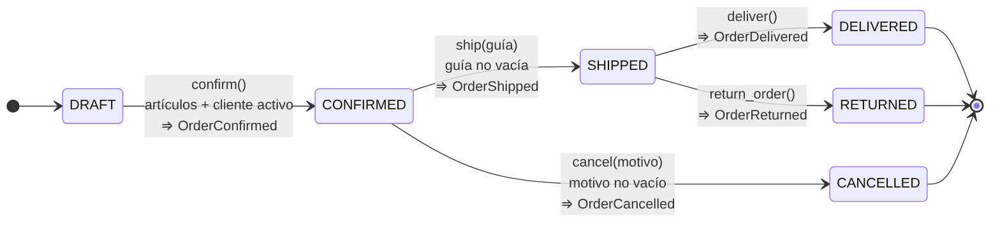

# Reporte · Actividad 4 · TechStore

## 1. Diagrama de estados



```
DRAFT --confirm--> CONFIRMED --ship--> SHIPPED --deliver--> DELIVERED
                       |                  |
                     cancel             return
                       v                  v
                   CANCELLED           RETURNED
```

Cualquier transición que no aparece en el diagrama lanza `InvalidOrderTransition`. Ejemplos: confirmar dos veces, cancelar un pedido SHIPPED o entregar desde CONFIRMED. DELIVERED, CANCELLED y RETURNED son estados finales.

## 2. Domain Events

Un Domain Event registra un hecho que **ya ocurrió**; por eso su nombre está en pasado. Cada evento es un objeto inmutable (`DomainEvent`, `frozen=True`) con `name`, `order_id`, `customer_id`, `total`, `detail` (la guía o el motivo) y `occurred_at` en UTC.

| Evento | Se emite cuando | Condiciones previas |
|---|---|---|
| `OrderConfirmed` | DRAFT → CONFIRMED | El pedido tiene artículos y el cliente está activo |
| `OrderShipped` | CONFIRMED → SHIPPED | La guía no está vacía (se guarda en `detail`) |
| `OrderCancelled` | CONFIRMED → CANCELLED | El motivo no está vacío (se guarda en `detail`) |
| `OrderDelivered` | SHIPPED → DELIVERED | — |
| `OrderReturned` | SHIPPED → RETURNED | — |

Cada método sigue el mismo orden: **validar → cambiar `status` → agregar el evento**. Si una validación falla, se lanza la excepción antes de tocar el estado, así que el pedido no anuncia un hecho que no ocurrió. Las pruebas lo comprueban; por ejemplo, en E12 el segundo `confirm()` falla y `events` sigue teniendo un solo `OrderConfirmed`.

La entidad solo acumula sus eventos en `order.events`. Otros componentes, como un notificador de correo o el inventario, podrían suscribirse a ellos sin que `Order` los conozca.

## 3. Bitácora de escenarios (generada con `ejecutar_escenarios.py`)

| Caso | Estado inicial | Operación | Resultado real | Evento | Explicación |
|---|---|---|---|---|---|
| E01 | O001 DRAFT · 4 u · 2100.00 | evaluar descuento | **10 %** (−210.00) | ninguno | VIP, > 500, ≥ 4 unidades, sin promoción |
| E02 | O002 DRAFT · 2 u · 1050.00 | evaluar descuento | **0 %** | ninguno | No es VIP y el total es menor a 5000 |
| E03 | O003 DRAFT · 4 u · 2100.00 | confirm() | **Rechazo** `InvalidOrderData` | ninguno | Cliente C003 inactivo |
| E04 | O005 DRAFT · 4 u · 2100.00 | evaluar descuento | **0 %** | ninguno | La promoción activa bloquea ambos descuentos |
| E05 | O006 DRAFT · 1 u · 18000.00 | evaluar descuento | **5 %** (−900.00) | ninguno | Total > 5000 y sin promoción (no es VIP) |
| E06 | O007 DRAFT · 0 u · 0 | confirm() | **Rechazo** `InvalidOrderData` | ninguno | Pedido sin artículos |
| E07 | O008 DRAFT · 20 u · 2400.00 | confirm() | **CONFIRMED** | OrderConfirmed | 20 unidades exactas están permitidas |
| E08 | O009 DRAFT · 19 u · 2280.00 | add_item(SKU003 ×2) | **Rechazo** `OrderItemLimitExceeded` | ninguno | 19 + 2 = 21 > 20; el pedido conserva 19 |
| E09 | O010 DRAFT · 2 u · 500.00 | evaluar descuento | **0 %** | ninguno | 500 no es > 500 (además no es VIP y tiene 2 unidades) |
| E10 | O011 DRAFT · 3 u · 1500.00 | evaluar descuento | **0 %** | ninguno | VIP, pero solo 3 unidades (se requieren 4) |
| E11 | O012 DRAFT · 1 u · 850.00 | confirm() y ship("") | confirm OK; **ship rechazado** `InvalidOrderData` | OrderConfirmed | Falta la guía; queda en CONFIRMED |
| E12 | O013 DRAFT · 1 u · 600.00 | confirm() ×2 | 1.º OK; **2.º rechazado** `InvalidOrderTransition` | OrderConfirmed (uno solo) | No se confirma desde CONFIRMED |
| E13 | O014 DRAFT · 1 u · 600.00 | confirm, ship, cancel | **cancel rechazado** `InvalidOrderTransition` | OrderConfirmed, OrderShipped | No se cancela un pedido enviado |
| E14 | O015 DRAFT · 1 u · 450.00 | confirm, ship, return_order | **RETURNED** | OrderConfirmed, OrderShipped, OrderReturned | Devolución válida desde SHIPPED |
| E15 | O016 DRAFT · 1 u · 2100.00 | confirm, ship, deliver | **DELIVERED** | OrderConfirmed, OrderShipped, OrderDelivered | Entrega válida desde SHIPPED |

Observaciones sobre los datos:

- **E09 no prueba por sí solo el umbral estricto.** O010 fallaría aunque el código usara `>=`, porque no es VIP y tiene 2 unidades. Por eso `test_umbral_estricto_500_aislado` usa un pedido VIP con exactamente 500 y 4 unidades.
- **Ningún pedido del CSV cumple las dos reglas a la vez.** La prioridad del 10 % se demuestra en `test_prioridad_10_si_se_cumplen_ambas` con un pedido sintético.
- **O003 sí cumple la regla del 10 %**, porque el descuento no depende de que el cliente esté activo. Lo que se rechaza en E03 es la confirmación.

## 4. Preguntas del reporte

**¿Por qué se usa Decimal en lugar de float para precios?**
`float` guarda los números en binario y no representa exactamente muchos decimales: `0.1 + 0.2` da `0.30000000000000004`. Con dinero, esos errores se acumulan en sumas y porcentajes. `Decimal` hace aritmética decimal exacta. Además, debe construirse desde texto (`Decimal("600.00")`): `Decimal(600.00)` hereda la imprecisión del float. Por eso `Money` rechaza los valores que no sean `Decimal`.

**¿Cuál es la diferencia entre contar renglones y sumar unidades?**
Un renglón es un producto distinto dentro del pedido; las unidades son la suma de sus cantidades. O008 tiene **1 renglón** y **20 unidades**. El límite de 20 es de unidades: si se contaran renglones, O008 pasaría como "1" y se podrían agregar cientos de piezas. `Order.units` usa `sum(item.quantity ...)`.

**¿Qué ventaja tiene encapsular una regla en una Specification?**
La regla tiene nombre y se prueba de forma aislada (`VIPCustomerSpec`, `MinimumUnitsSpec`, etc.). Se combina con `&`, `|` y `~` sin repetir `if` en varias partes del código y se reutiliza en la API, en un proceso batch o en las pruebas. Si el negocio cambia el umbral de 500 a 800, se cambia en un solo lugar. Además, la Specification solo evalúa, no modifica el pedido, y aplicar el descuento queda como otra responsabilidad.

**¿Por qué los eventos se registran solo después de una transición válida?**
Un evento afirma que algo ocurrió y otros sistemas pueden reaccionar a él: enviar un correo, facturar, reservar inventario. Si se registrara antes de validar y la operación fallara, se anunciaría un hecho falso. Validar → cambiar estado → registrar evento garantiza que cada evento corresponde a un cambio real.

**¿Qué parte del código podrías reutilizar si reemplazas FastAPI por otra interfaz?**
Todo `app/domain.py` y `app/specifications.py`, además de `cargar_csv.py` y las pruebas de dominio. Ninguno importa FastAPI. Solo cambiaría `app/api.py`, que únicamente busca el pedido, llama al método de `Order` y traduce las excepciones a HTTP. El mismo núcleo serviría para una CLI, una interfaz gráfica o un proceso batch.

## 5. Reflexión (borrador: ajústala con tu experiencia)

1. **Límite de 20 con `>=`.** Si `add_item` usara `self.units + qty >= 20`, `cargar_csv.py` fallaría al cargar O008 (20 unidades exactas), porque el cargador llama a `add_item`. Se corrigió con `> 20` y una prueba de E07.
2. **El escenario E09 no aislaba el umbral.** O010 fallaba la regla del 10 % por varias razones, así que un error `>=` en `MinimumAmountSpec` pasaba sin detectarse. Se agregó una prueba con un pedido VIP de exactamente 500 y 4 unidades.
3. **`Money` con float.** `Money(600.00)` "funcionaba", pero introducía imprecisión. Ahora `Money` exige `Decimal` y hay una prueba de que rechaza float.

**Aprendizaje.** Las reglas deben vivir en el dominio y no en la API. Una prueba solo demuestra una regla si el caso falla por esa razón y no por otra. Y los eventos son confiables solo si se emiten después de una transición válida.
